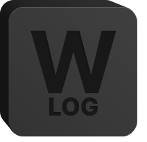

<p align="center">
  
</p>

<h1 align="center">Worcog</h1>

A local-first desktop workspace for topics, dated activity, tasks, manually
recorded external sources, and managed documents. Email, Teams and InvGate
references are entered manually. The app does not sign in to accounts, read
messages, synchronize data, or send telemetry. A new workspace contains no demo
records.

## Run locally

Install Node.js 22, the pnpm version declared in `package.json`, stable Rust and
the [Tauri platform prerequisites](https://v2.tauri.app/start/prerequisites/).
On Windows this includes the Microsoft C++ build tools and WebView2.

```sh
pnpm install --frozen-lockfile
pnpm tauri dev
```

`pnpm dev` starts the Next.js frontend alone. Native persistence, file dialogs,
backup and restore require `pnpm tauri dev`; a browser preview cannot substitute
for the desktop runtime.

## Work with your data

Open **Documentation** in the sidebar for the complete guide to topics, tasks,
updates, resources, contacts, document editing, sharing, settings and keyboard
shortcuts. It is available offline and uses [the user guide](docs/user-guide.md)
as its single source. Keep that guide current when changing user-facing behavior.

Start with a topic, then create tasks in its workspace. Assign contacts, add
sources and files through task forms, and record progress with **Add update**.
Checkboxes complete tasks; blocking requires a reason. Archive topics to preserve
their context without keeping them in active views.

Ctrl+click (Windows) or Command+click (macOS) attachments on task cards to select them for sharing, then choose
**Export** at the lower right. A single file is exported as a copy; multiple
files become a ZIP. This differs from a full workspace archive.

Use **Settings → General** for appearance, indicators and the optional embedded
document editor. Use **Settings → Storage & backups** for workspace backup,
export, restore and deletion, and **Settings → Updates** for verified Windows
EXE or macOS app ZIP downloads for manual replacement. General settings also
include separate configurable shortcut profiles for Windows and macOS.

See [storage and recovery](docs/storage.md) before moving or restoring data,
and [application updates](docs/updates.md) for update credentials and limits.
Primary data is local and persistent; cache is separate. Backups and exported
documents contain confidential information and are not encrypted.

## Checks and packaging

```sh
pnpm lint
pnpm typecheck
pnpm test
pnpm test:native
pnpm release:validate
pnpm build
pnpm exec playwright install chromium
pnpm test:ui
pnpm tauri build --target x86_64-pc-windows-msvc --no-bundle -- --locked
```

The final command produces the portable Windows EXE and requires Windows.
GitHub Actions provides **Windows build** and **macOS build** workflows; run
either manually to download its artifact. macOS produces a universal ZIP
containing `Worcog.app`. See [release and desktop build instructions](docs/releases.md) for
triggers, artifact retention, and Release Please behavior.

See [architecture](docs/architecture.md) and [development](docs/development.md)
for module boundaries, date conventions, supported scope, and validation.

See the [validation handoff](docs/validation.md) for executed checks, platform
limitations and Git status.
